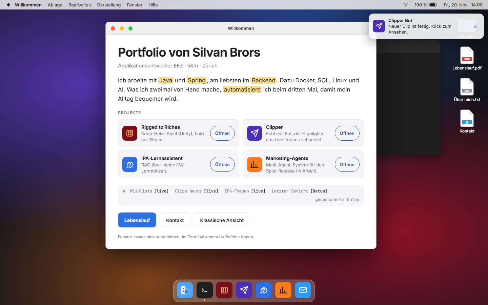
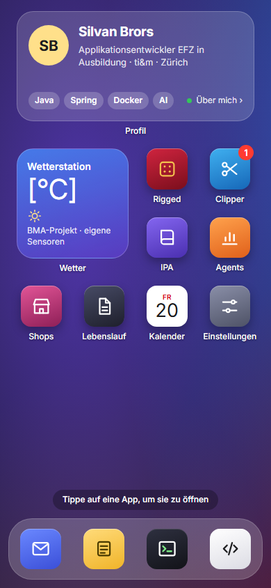
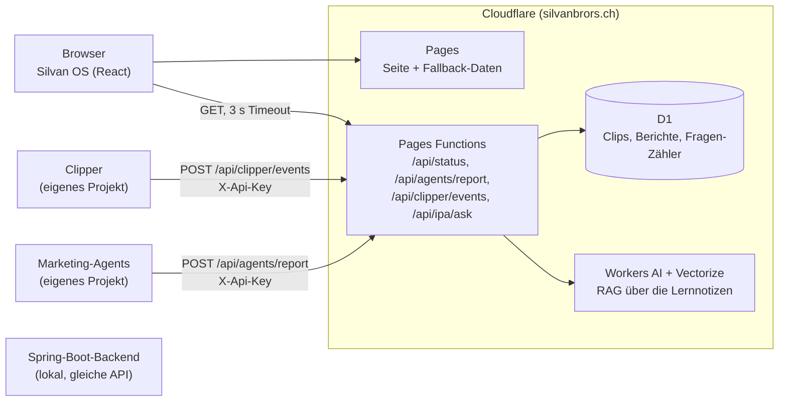

# Silvan OS

Mein Portfolio als Desktop im Browser: Projekte öffnen sich als Apps in verschiebbaren
Fenstern, im Terminal kann man Befehle eingeben, und die Live-Zahlen kommen aus einem
eigenen Spring-Boot-Backend. Auf dem Handy wird daraus ein Home-Bildschirm mit Widgets und Apps.

**Live:** [silvanbrors.ch](https://silvanbrors.ch)





<sub>Oben am Computer, unten unter 860 px Breite (eigene Handy-Ansicht). Das Backend ist noch nicht
online, die Live-Zahlen zeigen deshalb Platzhalter.</sub>

## Stack
- **Frontend:** React 19, TypeScript, Vite, Vitest. Fenster, Drag, Dock und Menüleiste sind selbst gebaut, ohne UI-Framework.
- **Backend:** Spring Boot 4, Java 21, Postgres mit Flyway, Bucket4j fürs Rate-Limit.
- **Live auf Cloudflare (gratis):** Pages (Seite), Pages Functions mit D1 (API, gleiches Verhalten
  wie das Spring-Backend), Workers AI und Vectorize (IPA-Assistent).
- **Betrieb:** Docker, GitHub Actions.

## Architektur



- Antwortet das Backend nicht, zeigt die Seite die gespeicherten Daten aus `frontend/src/data/`.
  Sie sieht nie leer oder kaputt aus.
- Clipper und Agents schicken ihre Daten selbst. Das Backend fragt keine fremden Dienste pro Request ab.
- Der IPA-Chat ist lokal an das separate Projekt `ipa-assistant` angebunden. Auf der Live-Seite
  antwortet eine Cloudflare Pages Function als RAG über meine Lernnotizen (Workers AI + Vectorize).
  Die Notizen liegen nur im Index, nicht im Repo, und werden nicht wörtlich herausgegeben.
- Das Spring-Boot-Backend (`backend/`) hat dieselbe API und läuft lokal. Live übernehmen die Pages
  Functions, damit alles gratis bei Cloudflare liegt.

API: [`docs/api.md`](docs/api.md)

## Lokal starten
```bash
cp .env.example .env       # POSTGRES_PASSWORD setzen
docker compose up --build  # backend (localhost:8080) + postgres (localhost:5433)
cd frontend && npm install && npm run dev
```

Ports belegt? In `.env` `BACKEND_PORT` bzw. `POSTGRES_PORT` ändern und im Frontend
`VITE_API_URL` in `frontend/.env.local` anpassen (Vorlage: `frontend/.env.example`).
Ohne Backend zeigt die Seite die gespeicherten Daten aus `frontend/src/data/`.

Tests: `npm run lint && npm run test` in `frontend/`, `./mvnw verify` in `backend/`.
Die Backend-Tests brauchen Docker (Testcontainers).

## Deployment
Alles auf Cloudflare: Seite (Pages), API (Pages Functions + D1) und IPA-Assistent (Workers AI +
Vectorize) unter silvanbrors.ch. Nach jedem Merge auf `main` wird automatisch deployt.
Einrichtung und Rollback: [`docs/deploy.md`](docs/deploy.md).

## Projekte, die man im Desktop findet
- **Rigged to Riches**: Koop-Heist-Spiel (Unity), bald auf Steam
- **Clipper**: Echtzeit-Bot, der Highlights aus Livestreams schneidet
- **IPA-Lernassistent**: RAG über meine IPA-Lernnotizen
- **Marketing-Agents**: Multi-Agent-System für den Spiel-Release (in Arbeit)

## Doku
- Plan und Stand: [`docs/plan.md`](docs/plan.md)
- Fehlende Inhalte (Fotos, Trailer, Lebenslauf): [`docs/inhalte.md`](docs/inhalte.md)
- Lighthouse-Messung: [`docs/lighthouse.md`](docs/lighthouse.md)
