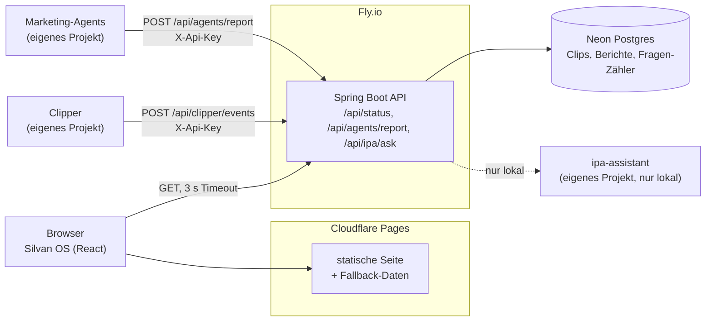

# Silvan OS

Mein Portfolio als Desktop im Browser: Projekte öffnen sich als Apps in verschiebbaren
Fenstern, im Terminal kann man Befehle eingeben, und die Live-Zahlen kommen aus einem
eigenen Spring-Boot-Backend.

**Live:** [Link folgt]


<sub>Screenshot vom lokalen Build ohne Backend: Die Live-Zahlen zeigen deshalb Platzhalter.</sub>

## Stack
- **Frontend:** React 19, TypeScript, Vite, Vitest. Fenster, Drag, Dock und Menüleiste sind selbst gebaut, ohne UI-Framework.
- **Backend:** Spring Boot 4, Java 21, Postgres mit Flyway, Bucket4j fürs Rate-Limit.
- **Betrieb:** Docker, GitHub Actions, Cloudflare Pages (Frontend), Fly.io (Backend), Neon (Postgres).

## Architektur



- Antwortet das Backend nicht, zeigt die Seite die gespeicherten Daten aus `frontend/src/data/`.
  Sie sieht nie leer oder kaputt aus.
- Clipper und Agents schicken ihre Daten selbst. Das Backend fragt keine fremden Dienste pro Request ab.
- Der IPA-Chat ist an das separate Projekt `ipa-assistant` angebunden, aber nur lokal. Auf der
  Live-Seite zeigt er Beispielantworten.

API: [`docs/api.md`](docs/api.md)

## Lokal starten
```bash
cp .env.example .env       # POSTGRES_PASSWORD setzen
docker compose up --build  # backend (localhost:8080) + postgres (localhost:5433)
cd frontend && npm install && npm run dev
```

Ports belegt? In `.env` `BACKEND_PORT` bzw. `POSTGRES_PORT` ändern und im Frontend
`VITE_API_URL` in `frontend/.env.local` anpassen (Vorlage: `frontend/.env.example`).
Ohne Backend zeigt die Seite die gespeicherten Daten aus `frontend/src/data/`.

Tests: `npm run lint && npm run test` in `frontend/`, `./mvnw verify` in `backend/`.
Die Backend-Tests brauchen Docker (Testcontainers).

## Deployment
Frontend auf Cloudflare Pages (silvanbrors.ch), Backend auf Fly.io (api.silvanbrors.ch),
Datenbank auf Neon. Nach jedem Merge auf `main` wird automatisch deployt. Einrichtung und Rollback:
[`docs/deploy.md`](docs/deploy.md).

## Projekte, die man im Desktop findet
- **Rigged to Riches**: Koop-Heist-Spiel (Unity), bald auf Steam
- **Clipper**: Echtzeit-Bot, der Highlights aus Livestreams schneidet
- **IPA-Lernassistent**: RAG über meine IPA-Lernnotizen
- **Marketing-Agents**: Multi-Agent-System für den Spiel-Release (in Arbeit)

## Doku
- Plan und Stand: [`docs/plan.md`](docs/plan.md)
- Fehlende Inhalte (Fotos, Trailer, Lebenslauf): [`docs/inhalte.md`](docs/inhalte.md)
- Lighthouse-Messung: [`docs/lighthouse.md`](docs/lighthouse.md)
